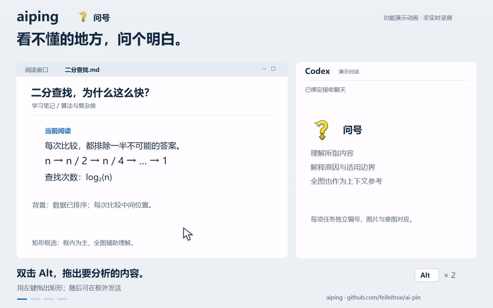
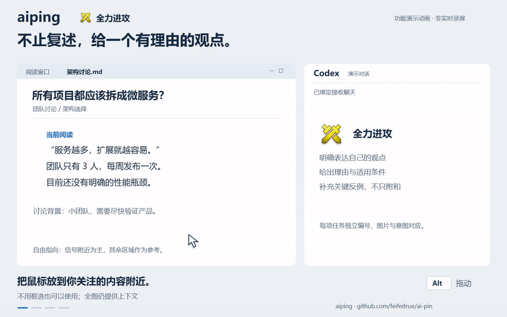
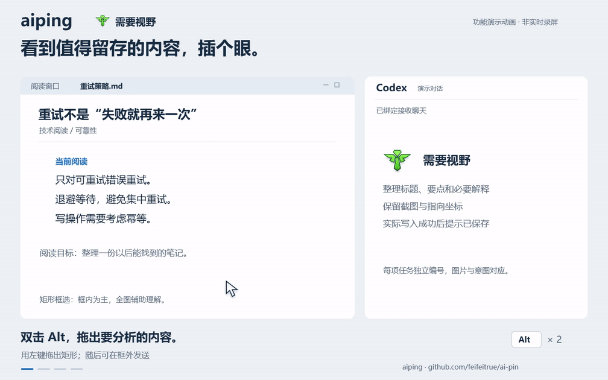
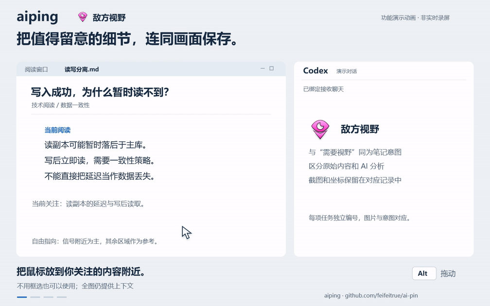
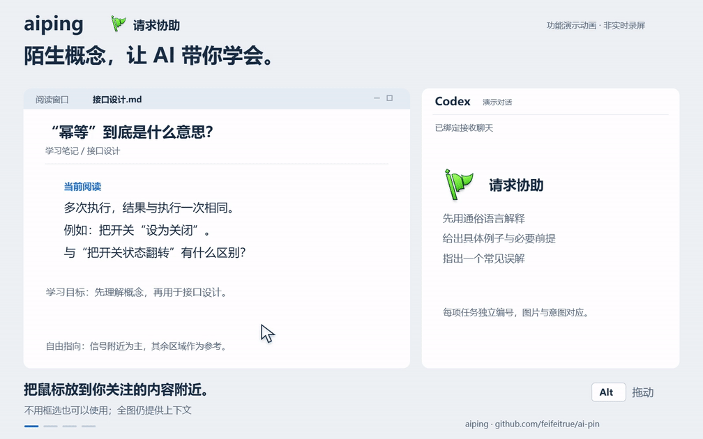

# aiping · 桌面信号 + Codex AI

> **当前支持范围：AI 联动暂时只支持 Codex Windows 桌面版。** 暂不支持 Codex 网页版、CLI、macOS 桌面版或其他 AI 工具；普通本地 ping 无需连接 Codex。

在桌面上发出 ping，用截图和指向位置向 Codex 提问；也可以先框出重点，再发信号。普通 ping 保持独立可用。

本项目基于 **[Danrui Meng（darrenprx）](https://github.com/darrenprx)** 开发的 **[lolPing](https://github.com/darrenprx/lolPing)** 修改，基线版本为 0.5.1。感谢原作者提供的桌面信号轮盘、动画音效播放和原生输入实现。本仓库是独立维护的二次开发版本，不是原作者的官方发行版。

> 本项目由维护者作为非商业、纯娱乐与学习交流的同人二创项目维护，不收费、不售卖。若权利人认为本项目内容涉及侵权，请联系 **[fefeedong@gmail.com](mailto:fefeedong@gmail.com)**，维护者将及时核实并删除相关内容。该声明不代表已获得第三方素材授权，也不替代适用的许可证。

## 功能演示

以下为按真实交互编排的**功能演示动画，非实时录屏**；回答为预设示例，等待时间已缩短。每段约 18 秒，GIF 无声，MP4 带对应信号音效。

### 问号：解释所指内容

框选内容，在选区外发问号；以框内为主解释原因与适用边界。



[查看有声 MP4](docs/media/aiping/aiping-question.mp4)

<details>
<summary>全力进攻：表达观点（展开动画）</summary>

针对所指话题给出明确观点、理由、适用条件和关键反例。



[查看有声 MP4](docs/media/aiping/aiping-allin.mp4)

</details>

<details>
<summary>需要视野：整理并保存（展开动画）</summary>

框选值得留存的内容，整理笔记，写入成功后才提示已保存。



[查看有声 MP4](docs/media/aiping/aiping-needvision.mp4)

</details>

<details>
<summary>敌方视野：分析并记录（展开动画）</summary>

自由指向内容，保存正文、原图、局部图和对应坐标。



[查看有声 MP4](docs/media/aiping/aiping-enemyvision.mp4)

</details>

<details>
<summary>请求协助：带你理解知识（展开动画）</summary>

先通俗讲解，再举例、对比并指出常见误解。



[查看有声 MP4](docs/media/aiping/aiping-assist.mp4)

</details>

## 各种 ping 的功能状态

**全部 11 种 ping 的本地图标、动画和音效都可用。** 下表的“待实现”仅指用户发出该信号后对应的 **AI 联动功能**，不表示普通桌面信号不能使用。

| 信号 | 用户发送后的 AI 功能 | 状态 |
| --- | --- | --- |
| 问号 / 敌人消失（missing） | 理解所指内容，解释原因与适用边界 | 已实现 |
| 全力进攻（allin） | 给出观点、理由、条件及关键反例 | 已实现 |
| 需要视野（needvision） | 分析并保存正文、截图和坐标 | 已实现 |
| 敌方视野（enemyvision） | 分析并保存正文、截图和坐标 | 已实现 |
| 请求协助（assist） | 通俗讲解知识、举例并指出常见误解 | 已实现 |
| 危险（danger） | 待设计的 AI 行为 | 待实现，欢迎提 Issue |
| 推进（push） | 待设计的 AI 行为 | 待实现，欢迎提 Issue |
| 正在赶来 / 正在路上（omw） | 用户主动发送后的 AI 行为 | 待实现，欢迎提 Issue |
| 普通信号（generic） | 待设计的 AI 行为 | 待实现，欢迎提 Issue |
| 诱饵（bait） | 待设计的 AI 行为 | 待实现，欢迎提 Issue |
| 视野已清除（visioncleared） | 待设计的 AI 行为 | 待实现，欢迎提 Issue |

自动提醒已实现：Codex 需要回答或审批时发出“请求协助”，本轮结束时发出“正在赶来 / 正在路上”。这些是程序提醒，不会再次触发截图或 AI 任务，与用户主动发送信号的 AI 映射分别处理。

对尚未实现的信号有想法？欢迎 [提交 Issue](https://github.com/feifeitrue/ai-pin/issues/new)，说说你希望在哪个场景使用这个 ping，以及期待 AI 做什么。

## 即将推出

**支持自定义 ping 提示词的版本很快也会到来。** 届时可以按自己的习惯设置各个 ping 要交给 AI 的指令。当前发布版尚未提供这个设置；欢迎在 [Issues](https://github.com/feifeitrue/ai-pin/issues) 分享想法和使用场景。

## 相比原项目改了什么

| 范围 | 本版本内容 |
| --- | --- |
| 保留本地 ping | 全部 11 种普通信号、轮盘拖动与松手发送、取消、全局快捷键、动画音效、多屏定位、透明穿透覆盖层、不抢焦点、暂停与全屏暂停、托盘及中文设置。 |
| 增加 Codex 联动 | 从界面连接已安装并登录的 Windows Codex 桌面版，选择接收聊天；无需单独安装 Node、填写 API Key 或修改 Codex hooks。 |
| 增加截图分析 | 问号解释位置；全力进攻给出观点、理由和反例；需要视野/敌方视野分析并保存笔记；请求协助讲解知识、举例并指出常见误解。 |
| 增加矩形框选 | 双击左 Alt 进入框选，拖出选区后可在任意位置发信号。分析以框内为主、全图为上下文；信号始终显示在鼠标起点。自由指向模式以信号附近为主，也参考全图。 |
| 增加任务对应与提醒 | 每项任务独立编号，保存截图、坐标、意图和结果；连续截图立即开始、按序发送。监听本机用户聊天的回答/审批等待和真实完成事件，分别播放协助/正在路上提醒；程序提醒不再次触发截图。 |
| 删除非核心扩展 | 联机房间、成员管理、局域网发现、互联网中继及专用协议/加密；表情轮盘、自定义表情与导入；自动检查、下载和安装更新及相关依赖。AI 所需网络和图片能力保留。 |

修改内容由本仓库维护者整理与开发，使用 Codex 辅助实施。源代码继续采用 MIT；第三方图标和音效不适用 MIT。

## 开始使用

**[下载 Windows x64 安装包（0.5.3）](https://github.com/feifeitrue/ai-pin/releases/download/windows-0.5.3-preview.1/aiping-Setup-0.5.3.exe)** · [安装与连接说明](https://github.com/feifeitrue/ai-pin/releases/tag/windows-0.5.3-preview.1)

建议使用 AI 助手协助完成安装和初次使用；也可以按照下面的步骤自行操作。

### 安装后如何连接 Codex

1. **安装 aiping。** 下载上方 `.exe`，按向导安装，再从桌面或开始菜单快捷方式启动。
2. **打开 Codex 桌面版并登录。** 新建或打开一个接收截图的聊天，例如“aiping 助手”，先发送一句消息，方便在列表中识别。
3. **发现 Codex。** aiping 首次启动会打开「Codex 连接」；之后也可从托盘打开设置，进入该页面，点击「连接 Codex」。
4. **选择聊天并启用。** 在列表中选择刚才的接收聊天，点击「连接并启用 AI」。确认页面显示「已连接」，并核对聊天名称。
5. **发出第一个 AI 信号。** 打开一段不含敏感信息的内容，将鼠标放到想问的位置，按设置中的触发方式打开轮盘，拖动选择问号并松手发送。在绑定的 Codex 聊天中查看截图和回答。

无需另装 Node、填写 API Key、配置环境变量或修改 Codex hooks；使用 Codex 已有的账号、模型和权限设置。连接选择会保存，aiping 重启后自动恢复。更换聊天时，在「Codex 连接」中重新选择并连接即可。

找不到聊天时，确认 Codex 桌面版正在运行且已登录，在目标聊天发送一句消息，再回到 aiping 刷新列表。仍无法连接时，请在 Issue 中附上错误提示和 Codex 版本，勿上传连接凭据。

### 框选与日常使用

- **自由指向：** 将鼠标放在关注的内容附近，打开轮盘并发送。AI 以信号附近为重点，同屏其他区域也作为参考。
- **矩形框选：** AI 模式下连续短按两次左 Alt，用鼠标左键拖出矩形；随后在任意位置按住 Alt 拖动轮盘，松手发送。分析以框内为主，信号仍显示在鼠标起点。Esc、右键或再次双击左 Alt 取消。
- **普通信号：** 不连接 Codex 也能使用本地轮盘、动画和音效。各信号的 AI 功能见上方状态表。
- **自动提醒：** Codex 等待回答或审批时出现协助提醒，本轮结束时出现完成提醒；这些程序提醒不会再次截图。

框选使用进入时固定的截图，不会因随后切换窗口而换成另一张图片。截图会发送到你选择的聊天，发送前请留意画面中的敏感内容。

从 0.5.2 起，程序、窗口、托盘、快捷方式与安装包统一命名为 `aiping`。升级继续使用旧的 `lolPing` 数据目录，保留设置、截图、笔记和聊天绑定；内部兼容标识及旧环境变量不变。GitHub 仓库地址仍为 `feifeitrue/ai-pin`。详细操作、目录说明和构建要求见 [中文使用说明](README.zh-CN.md)。

## 从源码构建

需要 Node.js 22.12+（建议 24 LTS）、npm，以及 Windows Visual Studio C++ 桌面开发工具链。

```text
npm ci
npm run typecheck
npm run test:helper
npm test
npm run test:codex
npm run build
npm run dist
```

`npm run dist` 生成 Windows 安装包到 `release/`。日常开发可使用 `npm run dev`。macOS 原实现保留，但本版本的一键 Codex 接入仅支持 Windows，未做 macOS 实机验收。

## 0.5.3：降低后台监听负载

- 修复已结束、未加载的聊天仍不断读取的问题；聊天重新活跃时继续接收提醒，不重读整段历史。
- 先用轻量聊天状态筛选，仅对运行中的聊天读取审批状态；后台状态检查每批最多两个，失败后退避重试。
- 增加同一配置目录的连接进程互斥，避免同时启动两份服务。所有本机用户聊天的提问与完成提醒继续保留。
- 开发机完成真实提问、回答后状态清除和真实任务完成提醒验证。一次 30 秒采样中，连接进程 CPU 约 0.003%，两条活跃聊天约 24 次读取/分钟；这是特定环境的实测值，不是所有机器的性能保证。

从旧版升级前，请从托盘退出 aiping，再运行新版安装包。如果你另行手动运行过早期独立连接脚本，也应停止该脚本，避免与安装版重复监听。正常安装版用户无需另装或启动任何连接脚本。升级保留配置、截图和笔记，不自动清理用户数据。

## 数据与已知限制

- 开启 AI 后，截图及指向信息会发送到你选择的 Codex 聊天，按 Codex 自身的模型、账号和权限规则处理。发送前留意屏幕上的敏感内容。
- 默认截图保存在应用数据目录 `captures/`，笔记和结果在 `codex/tasks/`；聊天绑定保存在本机，不随源码分发。连接层会读取本机 Codex 会话记录以识别状态提醒。
- 发送队列在内存中，**不支持崩溃或退出恢复**。发送结果不明确时不会自动重发；笔记实际落盘后才提示已保存。
- Codex 连接使用桌面兼容接口，并非承诺长期稳定的公开集成 API。已验证桌面版 `26.1007.2314.0`，升级后需复测。
- 已在另一台安装了 Codex 的机器上安装测试了 aiping 安装包。
- 开发机已验证 Windows 双屏 100% 缩放；真实混合缩放和 macOS 尚未验收。
- 开发阶段曾通过 165 项应用测试及 26 项连接层测试。仓库 CI 用于对后续修改重新验证；不把自动测试当作所有实机项目均已通过。
- 自动软件更新已删除，升级需要手动安装。当前安装包未签名。

## 原作者、许可证与第三方素材

- 原项目：[darrenprx/lolPing](https://github.com/darrenprx/lolPing)。原作者：**Danrui Meng**，`Copyright (c) 2026 Danrui Meng`。
- 保留完整 [LICENSE](LICENSE)，源代码按 MIT 发布。维护者的非商业用途声明是项目运营说明，**不额外限制 MIT 已授予的代码使用权**。
- `assets/textures` 中的英雄联盟信号图标和 `assets/sounds` 中的音效属于 **© Riot Games, Inc.**，来自原项目，**不属于 MIT 授权**。本仓库不授予这些素材的额外使用权。
- 本项目不由 Riot Games、原项目作者或 OpenAI 赞助、背书或官方维护。相关商标归各自权利人所有。Riot 素材使用政策见 [Riot Games 官方法律页面](https://www.riotgames.com/en/legal)。
- 涉及权利问题请联系 **[fefeedong@gmail.com](mailto:fefeedong@gmail.com)**，提供相关内容的位置和权属说明；维护者将及时核实并删除相关内容。

`docs/design*.md` 和 `docs/media/` 中原有图片来自上游，可能包含本版本已删除的功能；`docs/media/aiping/` 是本版本新制作的功能演示动画。本版本功能以本 README 和当前源码为准。
